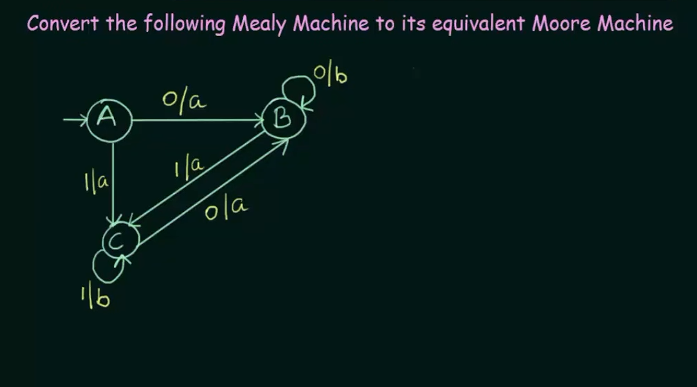
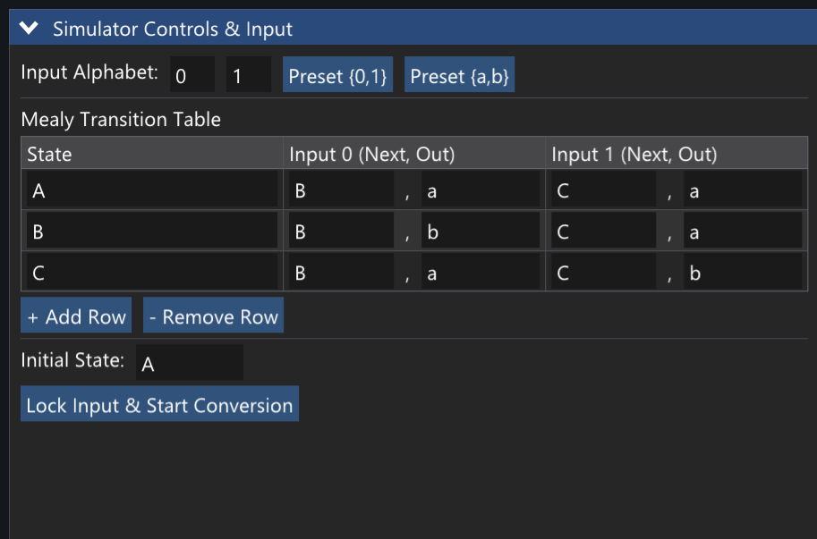
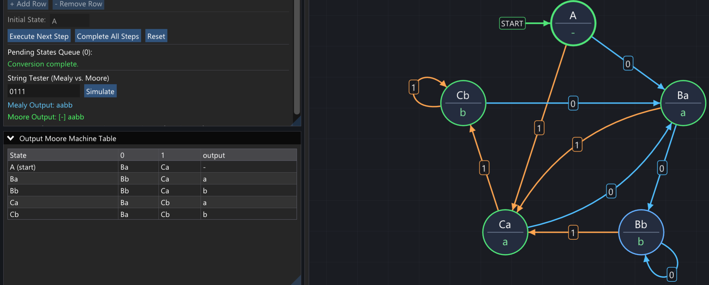

# Mealy-to-Moore Machine Converter & Simulator

An interactive, hardware-accelerated **Mealy-to-Moore Finite State Transducer (FST)** converter and string simulator written in **C++17**, **Dear ImGui**, and **OpenGL 3.0**, cross-compiled to **WebAssembly (WebGL2)** for browser execution.

> **Live Web App:** `https://2-claw-4-kennex.github.io/<your-repo-name>/`

---

## Features
* **Dynamic Input Alphabet:** Supports custom 2-symbol alphabets (`{0, 1}`, `{a, b}`, etc.) with one-click presets.
* **Cardinality-Based State Splitting:** Splits a Mealy state only when it receives conflicting incoming outputs, preventing redundant state duplication while preserving disconnected components.
* **Step-by-Step FIFO Wiring:** Inspect the pending state queue and wire transitions one state at a time or all at once.
* **Custom 2D Vector Graph Canvas:** Built directly on `ImDrawList` with cursor-anchored zoom (`20%–300%`), drag-to-pan, draggable circular `State / Output` nodes, quadratic Bézier curves for bidirectional edges, and outward cubic Bézier self-loops.
* **Dual-Trace String Equivalence Tester:** Executes any test string simultaneously on both the original Mealy machine and the converted Moore machine, highlighting the traversed path in green.

---

## User Manual: How to Convert a Mealy Machine

### Step 1: Read the Source Mealy Machine
Consider the following Mealy machine with states `{A, B, C}`, input alphabet `{0, 1}`, output alphabet `{a, b}`, and initial state `A`:

Each directed edge is labeled `Input / Output`:
* From **A**: on `0` go to `B` (output `a`); on `1` go to `C` (output `a`).
* From **B**: on `0` loop to `B` (output `b`); on `1` go to `C` (output `a`).
* From **C**: on `0` go to `B` (output `a`); on `1` loop to `C` (output `b`).

---

### Step 2: Fill the Transition Table (Exact Input Format)
Open the **Simulator Controls & Input** panel and configure your machine **before** locking the input:

1. **Set the Input Alphabet:** Enter your two input symbols in the `Input Alphabet` boxes at the top (for this problem: `0` and `1`).
2. **Add or Remove Rows:** Click **`+ Add Row`** or **`- Remove Row`** until you have one row per Mealy state (`A`, `B`, `C`).
3. **Enter Each Row Strictly as `State` | `Next , Out` | `Next , Out`:**
   * **Column 1 (`State`):** Enter the state name (e.g., `A`).
   * **Column 2 (`Input 0 (Next, Out)`):** Enter the destination state in the **left** box (`B`) and the transition output in the **right** box (`a`).
   * **Column 3 (`Input 1 (Next, Out)`):** Enter the destination state in the **left** box (`C`) and the transition output in the **right** box (`a`).
4. **Set the Initial State:** Type the exact starting state name (`A`) into the **`Initial State`** field.
5. **Lock & Initialize:** Click **`Lock Input & Start Conversion`** to split conflicting states (`B -> Ba, Bb`, `C -> Ca, Cb`) and lay out the Moore states.

---

### Step 3: Run Conversion, Inspect the Graph & Test Strings

1. Click **`Execute Next Step`** (state-by-state) or **`Complete All Steps`** to wire all transitions.
2. Enter a string using symbols from your `Input Alphabet` (e.g., `0111`) and click **`Simulate`**. For `0111`, **Mealy Output** is `aabb` and **Moore Output** is `[-] aabb`, with visited states highlighted in **green**.
3. Use the **scroll wheel** to zoom, **drag the background** to pan, and **drag any circle** to reposition nodes.
